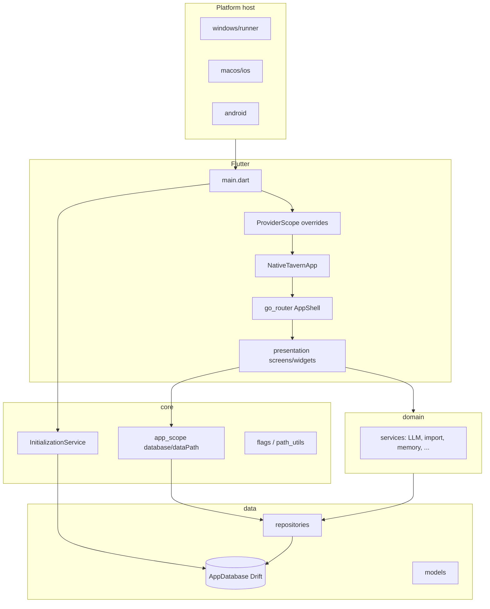

# NativeTavern 架构与代码组织

NativeTavern 是跨平台 Flutter 客户端（iOS / Android / Windows / macOS / Linux），对标 SillyTavern 能力集：角色卡、多供应商 LLM、世界书、群聊、扩展设置与本地数据主权。

**技术栈摘要：** Flutter 3.44+、`flutter_riverpod`、`go_router`、`drift`（SQLite schema **v25**）、`dio`、可选 Live2D / Spine / MCP / 本地 QNN 插件。

---

## 1. 整体架构

### 1.1 运行时结构



**启动顺序（`lib/main.dart`）：**

1. `InitializationService.initialize()`：数据目录、Drift、`PathUtils`、内置角色/世界书种子。
2. 构造仓储与服务（角色、聊天、世界书、LLM、导入、审计、同意书等）。
3. `ProviderScope` **override** 注入 `databaseProvider`、`dataPathProvider`、核心仓储与服务（避免未初始化访问）。
4. `NativeTavernApp`：`MaterialApp.router` + 主题/语言 + 全局 `worldRuntimeProvider`、`momentContextRegistrationProvider` 等副作用监听。

### 1.2 导航与 Shell

- **路由定义：** `lib/presentation/router/app_router.dart`（`AppRoutes` 常量 + `StatefulShellRoute.indexedStack`）。
- **壳层：下栏 / 侧栏 + 三栏主从** `lib/presentation/widgets/common/app_shell.dart`、`master_detail_branch.dart`、`desktop_layout.dart`。
- **桌面沉浸标题栏：** `desktop_caption.dart` + Windows `flutter_window.cpp`（Flutter 自绘最小化/最大化/关闭）。
- **栈覆盖：** `shell_stack_page.dart`、`opensOnRootInBottomNav` — 从底栏 Tab 打开设置子页、聊天等时保持 Tab 选中状态。

**Shell Tab 枢纽（`AppRoutes.isShellTabHub`）：** 首页、角色、游玩、AI 配置、外观、设置。

### 1.3 状态管理

- **Riverpod：** 界面读配置/列表 → `presentation/providers/*`；重业务在 `domain/services`，由 Notifier 或 Service 调用。
- **活动聊天：** `activeChatProvider` / `ActiveChatNotifier`（`chat_providers.dart`）— 单会话内存态 + 生成流水线；消息编辑已抽出 `ActiveChatMessageEdits`（`active_chat_message_edits.dart`）。
- **输入区：** `ChatComposer`（`chat_composer.dart`）— 草稿、附件、快捷面板；发送回调由 `ChatScreen` 转给 Notifier。

### 1.4 数据与文件

- **数据库：** `lib/data/database/database.dart` — 角色、聊天、消息、世界书、人设、群组、书签、标签、长期记忆、RPG、资料库、故事章节、朋友圈等表。
- **用户文件：** `{Documents}/NativeTavern/` — 角色资源、Live2D、附件、聊天导出、备份、审计日志等（`InitializationService` + `path_utils`）。

---

## 2. 代码分层设计

### 2.1 层级与依赖规则（目标态）

| 层 | 路径 | 职责 | 允许依赖 |
|----|------|------|----------|
| **core** | `lib/core/` | 启动、全局 scope、特性开关、与框架无关的小工具 | `data`（仅启动读库）、`domain`（极少） |
| **data** | `lib/data/` | Drift schema、DTO/表模型、仓储实现、部分 IO 适配 | `domain` 接口（若有）、**不依赖** `presentation` |
| **domain** | `lib/domain/` | 业务服务、领域模型、供应商适配（LLM/工具/MCP） | `data` 模型与仓储 **通过构造注入**，避免 UI import |
| **presentation** | `lib/presentation/` | 页面、可复用控件、主题、Riverpod 装配、路由 | `core`、`data` 模型、`domain` services |
| **l10n** | `lib/l10n/` | ARB + 生成文案 | 无业务依赖 |

**应用根：** `lib/main.dart`、`lib/app.dart` — 组装层，可触及各层。

```text
presentation ──► domain ──► data ──► (sqlite / filesystem)
       │              │
       └──────► core (app_scope, init)
```

### 2.2 耦合现状（重构进行中，文档如实记录）

| 现象 | 说明 | 归类 |
|------|------|------|
| `data/repositories/*_repository.dart` 内声明 Riverpod `Provider` | 如 `characterRepositoryProvider`；bookmark/persona/group  watch `databaseProvider` | 数据层带 DI 声明 |
| `databaseProvider` / `dataPathProvider` | `lib/core/app_scope.dart` — 避免 data→presentation | 已抽离 |
| Tag 颜色 | 存库为 hex；`TagColor` / `TagColors` 在 `presentation/theme/tag_colors.dart` | 已抽离 |
| Live2D / debug 日志 Provider | `presentation/providers/live2d_providers.dart`、`debug_log_providers.dart` | 已抽离 |
| `domain` 中 `flutter/foundation`（`debugPrint`）、`services`（`rootBundle`）、`widgets`（TTS 生命周期） | 平台/框架能力，非 Riverpod | 已知技术债 |
| 上帝文件 | `chat_providers.dart`、`chat_screen.dart`、`llm_service.dart`、`image_generation_service.dart` | 计划按协作类/策略拆分 |

**原则（与 `.cursor/rules` 一致）：** 一套产品 UI，视觉不随 `Platform.is*` 分叉；平台差异仅能力（文件选择、Live2D 宿主、备份、桌面 Enter 发送等）。

### 2.3 Provider 分布约定

| 类型 | 位置 | 示例 |
|------|------|------|
| 进程级单例（main override） | `main.dart` + 各 service/repository 文件 | `llmServiceProvider`、`chatRepositoryProvider` |
| 仅 presentation 使用 | `presentation/providers/` | `settings_providers`、`image_gen_providers` |
| 跨 data 的 DB/路径 | `core/app_scope.dart` | `databaseProvider`、`dataPathProvider` |
| 会话/屏幕状态 | 与功能同文件或 `*_providers.dart` | `activeChatProvider`、`rpgChatProvider` |

---

## 3. 文件树设计

### 3.1 仓库顶层

```text
NativeTavern/
├── lib/                 # Dart 应用（见下）
├── test/                # 单元 / 组件 / 集成测试（约 180+ 文件）
├── docs/                # 架构与产品文档
├── assets/              # 内置角色占位、世界书 JSON、示例 Live2D
├── packages/            # 本地插件（macOS Live2D、QNN upscale、Spine 兼容）
├── android/ ios/ macos/ windows/ linux/   # 各平台 Runner 与嵌入代码
├── l10n.yaml            # 多语言生成配置
└── pubspec.yaml
```

### 3.2 `lib/` 目录职责

```text
lib/
├── main.dart                 # 入口、ProviderScope overrides
├── app.dart                  # MaterialApp.router、全局监听（世界运行时、朋友圈上下文）
├── core/
│   ├── app_scope.dart        # databaseProvider, dataPathProvider
│   ├── flags/                # 产品开关，如 rpg_product_ui
│   ├── services/             # InitializationService
│   └── utils/                # path、share 等
├── data/
│   ├── database/             # Drift 表定义、迁移（database.dart, *.g.dart）
│   ├── models/               # 与表/JSON 对齐的结构（character, chat, rpg, story, moment…）
│   ├── repositories/         # Drift / 文件 仓储（20 个量级）
│   └── services/             # 偏数据的辅助（若有）
├── domain/
│   ├── models/               # 与 UI 无关的领域类型（如 tool_calling）
│   ├── repositories/       # 抽象接口（少量）
│   ├── services/             # 核心业务（LLM、记忆、资料库、RPG、备份…）
│   │   ├── tool_calling/     # OpenAI/Claude/Gemini 工具适配
│   │   ├── mcp/              # MCP 客户端
│   │   └── image_upscale/    # 放大后端
│   └── skills/             # 可复用技能块（若有）
├── presentation/
│   ├── controllers/          # 非 Riverpod 控制器（如 TTS 自动播放）
│   ├── providers/            # Riverpod（68 文件量级）
│   ├── router/               # app_router, shell_navigation
│   ├── screens/              # 按功能分目录的页面
│   │   ├── home/ chat/ character/ character_editor/
│   │   ├── settings/ ai_config/ import/ personas/
│   │   ├── world_info/ groups/ tags/ data_bank/ rpg/ play/
│   ├── theme/                # buildNativeTavernTheme, ZephyrChatChrome, tag_colors
│   ├── utils/                # 确认框等 UI 辅助
│   └── widgets/              # 可复用组件（chat/, common/, live2d/, settings/…）
└── l10n/                     # app_*.arb → generated/
```

### 3.3 `presentation/screens` 与路由映射（摘要）

| 目录 | 路由前缀 / 代表路径 | 作用 |
|------|---------------------|------|
| `home/` | `/` | 会话列表、搜索 |
| `chat/` | `/chat/:id` | 主聊天 UI |
| `character/` | `/characters`, `/characters/:id` | 浏览、详情 |
| `character_editor/` | `/characters/new`, `.../edit` | 角色卡编辑 |
| `settings/` | `/settings` 及大量子路径 | 全设置树 |
| `ai_config/` | `/ai-config` | LLM 连接与模型 |
| `import/` | `/import` | 导入向导 |
| `play/` | `/play`, `/play/story`, `/play/moments` | 游玩枢纽、故事、朋友圈 |
| `world_info/` | `/world-info` | 世界书 CRUD |
| `groups/` | `/groups`, `/groups/:id` | 群组 |
| `personas/` | `/personas` | 用户人设 |
| `tags/` | `/tags` | 标签管理 |
| `data_bank/` | `/data-bank` | 资料库文档 |
| `rpg/` | `/rpg-scenario-editor` | RPG 场景编辑 |

完整路径见 `AppRoutes`（`app_router.dart`）。

### 3.4 `presentation/widgets` 分包原则

| 子目录 | 用途 |
|--------|------|
| `common/` | AppShell、自适应脚手架、Chrome 按钮、桌面标题栏、主从分栏 |
| `chat/` | 气泡、输入区、VN 视图、TTS、上下文占用、出图面板等 |
| `character/` | 筛选条、库操作、卡片 chrome |
| `live2d/` | 舞台、手势、视图宿主 |
| `settings/` | 设置页共用行/区块 |
| `play/` | 游玩功能门控 |
| `rpg/` | RPG 面板 |
| `privacy/` | AI 数据共享同意门 |
| `regex/` | 正则脚本 UI 片段 |

**大块页面逻辑仍留在 `screens/*`**；可跨屏复用且与业务弱绑定的才下沉到 `widgets/`。

### 3.5 测试目录约定

| 模式 | 含义 |
|------|------|
| `*_test.dart`（根目录） | 单元 / 小部件 / 单屏 |
| `*_end_to_end_test.dart` | 多 Provider + 假 DB / 假 LLM 的流程 |
| `*_regression_test.dart` | 回归场景（导航、群聊等） |
| `test/domain/` | 纯领域（如 `reply_length_policy`） |
| `test/support/` | 迁移 harness、fixtures |
| `test/fixtures/` | JSON 等静态夹具 |

功能与测试对应见 [features.md](./features.md) 各节「测试」列。

### 3.6 本地 packages

| 包 | 作用 |
|----|------|
| `native_tavern_live2d_macos` | macOS Live2D 宿主 |
| `native_tavern_qnn_upscale` | Android QNN 动漫放大 |
| `spine_flutter_4_1_compat` | Spine 运行时兼容 |

### 3.7 数据库表（schema v25）与域模型对应

Drift 表定义见 `database.dart`（节选）：

- 核心对话：`Characters`, `Chats`, `Messages`, `Bookmarks`
- 世界与人设：`WorldInfos`, `WorldInfoEntries`, `Personas`, `Groups`
- 配置：`LlmConfigs`, `Tags`, `CharacterTags`, `GlobalStates`
- 记忆：`LongTermMemories`, `LongTermMemorySourceMessages`
- RPG：`RpgScenarios`, `RpgStateSnapshots`, `RpgChatStates`
- 资料库：`DataBankDocuments`, `Versions`, `Sections`, `TextChunks`, `DataBankBindings`
- 游玩：`StoryChapters`, `MomentPosts`, `MomentComments`, `MomentPostLikes`

迁移与兼容性由 `database_migration_harness_test` 等守护。

---

## 4. 关键横切能力

| 能力 | 主要代码 |
|------|----------|
| 主题与聊天 chrome | `presentation/theme/native_tavern_theme.dart`, `zephyr_chat_chrome.dart` |
| 国际化 | `lib/l10n/app_*.arb`, `l10n.yaml` |
| 能力探测与诊断 | `capability_registry.dart`, `capability_diagnostics_screen` |
| 外部调用审计 / AI 共享同意 | `external_call_audit_*`, `ai_data_sharing_consent_*` |
| 世界后台 tick | `world_runtime.dart`, `worldRuntimeProvider` |
| 调试日志浮层 | `debug_log_service.dart`, `debug_log_overlay.dart` |

---

## 5. 后续架构工作（计划，非本文规范）

1. 继续拆分 `ActiveChatNotifier`（加载/发送/群聊等协作类）。
2. `LLMService` / `ImageGenerationService` 按供应商策略对象化。
3. 减少 `data` 层 Riverpod 声明，统一装配边界（可选 `core/di` 或保持 main override 模式）。
