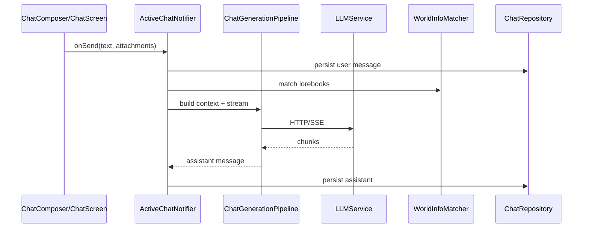

# NativeTavern 功能目录与边界

本文按**用户可感知能力**划分模块，标明代码位置、数据落点、测试与**功能边界**（包含 / 不包含 / 与其他模块交界）。

图例：

- **持久化：** `DB` = Drift 表；`FS` = 用户数据目录文件；`Prefs` = SharedPreferences；`Secure` = flutter_secure_storage
- **测试：** 代表性文件，非 exhaustive

---

## A. 应用壳层与导航

| 能力 | 入口 | 主要代码 | 持久化 | 测试 | 边界 |
|------|------|----------|--------|------|------|
| 底栏 / 侧栏 Shell | 全局 | `widgets/common/app_shell.dart`, `adaptive_scaffold.dart` | — | `app_shell_bottom_nav_test`, `shell_tab_hub_test` | **不含**各 Tab 内业务逻辑 |
| 桌面三栏主从 | 宽窗口 | `master_detail_branch.dart`, `desktop_layout.dart`, `desktop_layout_providers.dart` | `Prefs`（主栏宽度） | `desktop_three_pane_layout_test` | 窄屏退化为单栈；**边界**与移动底栏共用路由 |
| 栈覆盖打开子页 | 底栏进设置/聊天等 | `shell_stack_page.dart`, `AppRoutes.opensOnRootInBottomNav` | — | `shell_navigation_test`, `master_detail_shell_back_test` | **不含**子页自身功能 |
| 桌面窗口按钮 | Windows 顶栏 | `desktop_caption.dart`, `windows/runner/flutter_window.cpp` | — | `desktop_caption_test` | **仅 Windows** 沉浸标题栏；macOS 用系统 chrome |
| 返回/未保存拦截 | 聊天页返回 | `chat_screen.dart` `PopScope`, `_handleUnsavedLeave` | `DB` 聊天脏标 | `chat_screen_lifecycle_test` | 仅活动聊天会话 |

---

## B. 首页与会话列表

| 能力 | 入口 | 主要代码 | 持久化 | 测试 | 边界 |
|------|------|----------|--------|------|------|
| 会话列表 / 新建 | `/` | `screens/home/home_screen.dart`, `chat_providers.dart` `PagedChatsNotifier` | `Chats` | `chat_list_search_test`, `home_group_chat_regression_test` | **不含**聊天内消息逻辑 |
| 群聊会话入口 | 首页 | `group_providers.dart`, `Groups` 表 | `DB` | `group_chat_regression_test` | 群聊生成逻辑在 `ActiveChatNotifier` 群分支 |

---

## C. 聊天（核心）

| 能力 | 入口 | 主要代码 | 持久化 | 测试 | 边界 |
|------|------|----------|--------|------|------|
| 消息列表 / 滚动跟随 | `/chat/:id` | `chat_screen.dart`, `chat_tail_scroll.dart`, `chat_message_bubble.dart` | `Messages` | `chat_tail_scroll_test`, `chat_screen_lifecycle_test` | VN 模式：`visual_novel_message_view.dart` |
| 输入 / 附件 / 快捷菜单 | 聊天底栏 | `chat_composer.dart` | 附件 `FS` | `chat_screen_lifecycle_test`, `moments_compose_draft_test`（菜单 key） | 发送 API 校验在 Screen 回调；**窄宽工具栏横向滚动**防溢出 |
| 发送 / 流式生成 / 取消 | 发送钮 | `chat_providers.dart` `ActiveChatNotifier`, `chat_generation_pipeline.dart` | `Messages` | `chat_generation_pipeline_test`, `chat_extension_end_to_end_test` | LLM 协议在 `llm_service.dart` |
| 滑动回复 / 编辑 / 删除 | 气泡菜单 | `active_chat_message_edits.dart` + Notifier 委托 | `DB` | （模型测试分散） | **不含**重新生成（属生成流水线） |
| 重新生成 / 继续 / 扮演 | 菜单 / 扩展 | `ActiveChatNotifier` | `DB` | `chat_extension_end_to_end_test` | 需已配置 LLM |
| 书签 | 气泡 | `bookmark_dialog.dart`, `bookmark_repository.dart` | `Bookmarks` | `bookmark_model_test` | |
| 分支聊天 | 菜单 | `branchChatFromMessage` | 新 `Chat` | — | 从消息 ID 截断复制 |
| 导入导出聊天 | 菜单 | `chat_export_service.dart` | `FS` 导出 | — | JSON/JSONL；**不是**角色卡导入 |
| 群聊多角色回复 | 群会话 | Notifier 内 `_generateGroup*` | `DB` | `group_chat_regression_test`, `home_group_chat_regression_test` | 与单聊共用 UI |
| 作者注 / 链接世界书 | 聊天设置 | `author_note_dialog.dart`, `updateLinkedWorldBooks` | `Chats` | `memory_context_end_to_end_test` | 世界书内容在 world_info 模块 |
| 上下文占用指示 | 输入栏 | `context_usage_indicator.dart`, `context_usage_service.dart` | — | `context_window_service_test` | 估算 token，非供应商账单 |
| 回复长度策略 | 生成内 | `reply_length_policy.dart` | — | `reply_length_policy_test` | |
| Regex 展示/持久化 | 管道 | `chat_regex_facade.dart`, `regex_service.dart` | 脚本 `Prefs`/DB | `regex_pipeline_test`, `character_regex_provider_test` | 脚本编辑在设置 |
| 工具调用轮次 | 生成 | `tool_calling/*`, `built_in_tool_service.dart` | 操作日志 | `tool_*_test`, `built_in_tool_end_to_end_test` | MCP 见 M 节 |
| Data Bank 引用 | 生成上下文 | `data_bank_context_service.dart` | `DataBank*` | `data_bank_chat_end_to_end_test`, `data_bank_citation_preview_test` | 文档管理在 K 节 |
| 图片占位 / 出图挂接 | 气泡 / 菜单 | `chat_screen.dart` 出图流程 | `Messages` metadata | `generated_image_context_test` | 出图引擎见 H 节 |
| RPG 面板 | 聊天内（开关） | `rpg_game_panel.dart`, `rpg_chat_providers.dart` | `RpgChatStates` | `rpg_narrative_ui_end_to_end_test`, `rpg_rule_engine_end_to_end_test` | `kRpgProductUiEnabled` 门控 |
| 工具活动条 | 聊天底 | `tool_activity_panel.dart`, `chat_extension_providers.dart` | — | `tool_chat_integration_end_to_end_test` | |
| TTS 自动播放 | 流结束 | `chat_tts_autoplay_controller.dart`, `tts_service.dart` | 设置 | `chat_tts_end_to_end_test`, `tts_service_test` | STT 在输入栏语音钮 |
| Live2D 舞台 | 角色启用时 | `live2d_character_view.dart`, `sprite_display.dart` | 角色 assets | `live2d_*_test` | 模型文件 `FS`；设置见 G 节 |
| 聊天背景 | 角色外观 | `chat_background_widget.dart`, `background_providers.dart` | 角色/全局设置 | — | 与「外观」主题独立 |
| 模型与思考抽屉 | 输入栏 | `model_thinking_drawer.dart` | `LlmConfigs` | — | 选模型/effort |
| 快捷回复 / 回复选项 / 状态块面板 | 输入栏 | `chat_choice_panel.dart`, `status_block_panel.dart`, `chat_image_gen_panel.dart` | `Prefs` 配置 | `chat_choice_prompt_service_test`, `status_block_parser_test` | 刷新依赖 LLM |
| Markdown 输入快捷键 | 输入菜单 | `markdown_hotkey_service.dart`, `markdown_input_field.dart` | — | `markdown_hotkey_service_test` | |
| 记忆快照展示 | 聊天扩展 | `memory_context_usage_sheet.dart`, `long_term_memory_context_service.dart` | `LongTermMemories` | `memory_*_end_to_end_test` | 治理在设置收件箱 |

**聊天模块明确不包含：** 供应商账号计费、云端会话同步（无官方账号体系）、SillyTavern 服务端直连（纯本地客户端 + 用户自配 API）。

---

## D. 角色与角色库

| 能力 | 入口 | 主要代码 | 持久化 | 测试 | 边界 |
|------|------|----------|--------|------|------|
| 角色列表 / 文件夹 / 视图模式 | `/characters` | `character_list_screen.dart`, `character_folder_*` | `Characters`, 文件夹表 | `character_browse_path_test`, `character_folder_repository_test` | |
| 角色详情 | `/characters/:id` | `character_detail_screen.dart` | `DB` + `FS` 资源 | — | |
| 角色编辑 | new/edit 路由 | `character_editor_screen.dart` | `DB` | — | SD 外观字段服务出图，非剧情 |
| 标签筛选 | 列表 | `character_filter_bar.dart`, `tag_providers.dart` | `Tags` | `tag_model_test` | 颜色 UI：`tag_colors.dart` |
| 库打包导入导出 | 列表操作 | `character_library_pack_service.dart`, `character_library_import_service.dart` | `FS` | `character_library_pack_roundtrip_test`, `character_library_path_roundtrip_test` | PNG/JSON 卡 |
| 单卡导入导出 | 详情 / 导入页 | `character_card_export_service.dart`, `import_service.dart` | `FS` | `character_card_round_trip_test` | |
| 角色卡数字兼容 | 导入 | 各 import 路径 | — | `character_card_numeric_compatibility_test`, `compatibility_test` | |
| 删除级联聊天 | 删除角色 | `character_repository.dart` | `DB` | `character_delete_cascades_chats_test` | |
| 社区/支持链接回归 | — | `character_library_ops.dart` | — | `community_support_regression_test` | 非核心对话能力 |

---

## E. 导入中心

| 能力 | 入口 | 主要代码 | 持久化 | 测试 | 边界 |
|------|------|----------|--------|------|------|
| 统一导入 UI | `/import` | `import_screen.dart` | 依类型 | — | URL/文件/库；Live2D 绑 `live2d_providers` |
| 世界书导入 | 导入 | `world_info_import.dart` | `WorldInfos` | — | 编辑在 world_info 屏 |
| 正则脚本导入 | 角色相关 | `character_regex_import_service.dart` | — | `character_regex_import_test` | |

**不包含：** 自动从网页抓取角色（除非 URL 导入服务显式支持的类型）。

---

## F. 人设（Persona）

| 能力 | 入口 | 主要代码 | 持久化 | 测试 | 边界 |
|------|------|----------|--------|------|------|
| 多用户人设 | `/personas` | `personas_screen.dart`, `persona_repository.dart` | `Personas` | — | 活动人设影响宏与导出用户名 |

---

## G. 表现层：立绘 / Live2D / 精灵

| 能力 | 入口 | 主要代码 | 持久化 | 测试 | 边界 |
|------|------|----------|--------|------|------|
| 2D 精灵 | 设置 / 角色 | `sprite_service.dart`, `sprite_settings_screen.dart` | 角色 assets | `sprite_service_test` | |
| Live2D 加载与舞台 | 聊天 / 设置 | `live2d_service.dart`, `live2d_import_service.dart` | `FS` 模型目录 | `live2d_service_test`, `live2d_import_service_test` | 平台宿主差异 |
| Live2D 动作/TTS 联动 | 播放 | `live2d_action_orchestrator.dart`, `live2d_tts_playback_coordinator.dart` | — | `live2d_action_end_to_end_test` | |
| iOS 渲染缩放 | iOS | `live2d_ios_render_scale_service.dart` | — | `live2d_ios_render_scale_service_test` | **仅 iOS** |
| Spine | 可选 | `spine_runtime_service.dart`, `spine_flutter` package | `FS` | — | 与 Live2D 并行可选方案 |

---

## H. 图像生成与放大

| 能力 | 入口 | 主要代码 | 持久化 | 测试 | 边界 |
|------|------|----------|--------|------|------|
| 多供应商出图 | 设置 + 聊天 | `image_generation_service.dart`, `image_gen_providers.dart` | 历史 `FS`/设置 | `image_generation_service_test`, `image_gen_history_service_test` | 供应商分 provider 块（待策略化） |
| 提示词编排 | 对话框 | `image_prompt_composer.dart` | — | `image_prompt_composer_test` | |
| 自动随回复出图 | 聊天 | `chat_screen` + 设置开关 | `Messages` | `generated_image_context_test` | |
| Android QNN 放大 | 管道阶段 | `image_upscale/qnn_*`, package | — | `image_upscale_stage_test`, `local_qnn_image_gen_test` | **仅 Android + 库存在时** |
| CFG / 历史 | 设置 | `image_gen_settings_screen.dart`, `cfg_scale_providers.dart` | `Prefs` | `cfg_scale_settings_test` | |

**不包含：** 内置 SD WebUI 服务端（客户端调用户配置的 URL/API）。

---

## I. AI 连接与生成配置

| 能力 | 入口 | 主要代码 | 持久化 | 测试 | 边界 |
|------|------|----------|--------|------|------|
| LLM 供应商与密钥 | `/ai-config` | `ai_config_screen.dart`, `llm_service.dart` | `LlmConfigs`, `Secure` | `llm_config_persistence_test`, `gemini_streaming_regression_test`, `groq_compound_request_test` | 见 `LLMProvider` 枚举 |
| 连接配置档案键 | 多配置 | `settings_providers` / config 模型 | `DB`/`Prefs` | `connection_profile_key_test` | |
| 提示词管理器 | `/prompt-manager` | `prompt_manager_screen.dart` | `GlobalStates` 等 | `prompt_manager_preset_test` | |
| 预设 | `/ai-presets` | `ai_presets_screen.dart`, `ai_preset_providers.dart` | `DB` | — | |
| Instruct / 模板 | 高级 | `instruct_providers.dart` | `Prefs` | — | |
| Logit bias / CFG / Logprobs / Tokenizer | 各设置路由 | `logit_bias_service.dart`, `tokenizer_service.dart`, `logprobs_panel.dart` | `Prefs` | `logit_bias_service_test`, `think_tag_parser_test` | Logprobs **依赖供应商返回** |
| 向量存储 / Embedding | 设置 | `vector_storage_service.dart`, `embedding_service.dart` | `DB` 向量表 | `vector_search_test`, `vector_storage_loading_test`, `embedding_service_test` | |
| 翻译 | 设置 | `translation_service.dart` | 设置 | `translation_service_test` | 可选 API |
| 外部调用审计 | 全局 | `external_call_audit_service.dart` | `FS` 日志 | `external_call_audit_service_test` | |
| AI 数据共享同意门 | 首次 API | `ai_data_sharing_consent_gate.dart` | `Prefs` | `ai_data_sharing_consent_*_test` | 合规 UI，非法律建议 |

---

## J. 世界书（World Info）

| 能力 | 入口 | 主要代码 | 持久化 | 测试 | 边界 |
|------|------|----------|--------|------|------|
| CRUD / 条目 | `/world-info` | `world_info_screen.dart`, `world_info_repository.dart` | `WorldInfos`, `WorldInfoEntries` | `world_runtime_test`（注入） | |
| 聊天内匹配注入 | 生成 | `WorldInfoMatcher`（domain）, Notifier | — | `world_runtime_test` | **非**实时 MUD 世界仿真 |
| 内置示例世界书 | 首次启动 | `InitializationService`, `assets/world_info/` | `DB` | — | |

---

## K. 资料库（Data Bank）

| 能力 | 入口 | 主要代码 | 持久化 | 测试 | 边界 |
|------|------|----------|--------|------|------|
| 文档库 UI | `/data-bank` | `data_bank_screen.dart` | `DataBank*` 表 | `data_bank_screen_test` | |
|  ingestion（PDF 等） | 导入 | `data_bank_ingestion_service.dart` | `FS` + 块表 | `data_bank_ingestion_end_to_end_test`, `data_bank_pdf_native_integration_test` | 依赖 `pdfrx` 等 |
| FTS / 检索 | 搜索 | `drift_data_bank_repository.dart` | `DB` FTS | `data_bank_fts_repository_test` | |
| 聊天绑定与引用 | 角色/聊天 | `data_bank_bindings`, context 服务 | `DB` | `data_bank_end_to_end_test`, `data_bank_library_end_to_end_test` | **边界：** 不在此编辑聊天消息 |

契约：`data_bank_contract_test`。

---

## L. 长期记忆

| 能力 | 入口 | 主要代码 | 持久化 | 测试 | 边界 |
|------|------|----------|--------|------|------|
| 记忆写入 / FTS | 自动生成+设置 | `drift_long_term_memory_repository.dart`, `long_term_memory_governance_service.dart` | `LongTermMemories` | `long_term_memory_*_test` | |
| 收件箱治理 | `/memory-inbox` | `memory_inbox_screen.dart`, `memory_providers.dart` | `DB` | `memory_inbox_end_to_end_test` | 用户批准/拒绝 |
| 聊天上下文注入 | 生成 | `long_term_memory_context_service.dart` | — | `memory_context_end_to_end_test`, `memory_auto_extraction_end_to_end_test` | |
| 摘要压缩历史 | 生成 | `chat_summarization_service.dart` | `Chat` 摘要字段 | — | Token 超窗时 |

**不包含：** 跨设备记忆云同步。

---

## M. 工具调用与 MCP

| 能力 | 入口 | 主要代码 | 持久化 | 测试 | 边界 |
|------|------|----------|--------|------|------|
| 内置工具 | 生成循环 | `built_in_tool_service.dart`, `tool_generation_loop.dart` | 审计 | `built_in_tool_end_to_end_test` | |
| OpenAI/Claude/Gemini 适配 | 生成 | `tool_calling/*_adapter.dart` | — | `tool_calling_adapters_test`, `tool_calling_adapters_end_to_end_test` | |
| MCP 客户端 | `/mcp-settings` | `mcp/mcp_client_manager.dart`, `mcp_protocol_client.dart` | 设置 | `mcp_client_manager_test`, `mcp_protocol_end_to_end_test` | 需用户配置 MCP 服务器 |
| 工具 UI | 聊天 | `tool_calling_ui_test` | — | | |

---

## N. 群聊与标签

| 能力 | 入口 | 主要代码 | 持久化 | 测试 | 边界 |
|------|------|----------|--------|------|------|
| 群组 CRUD | `/groups` | `groups_screen.dart`, `group_repository.dart` | `Groups` | `group_detail_screen_test` | |
| 群详情 / 成员 | `/groups/:id` | `group_detail_screen.dart` | `DB` | `group_detail_screen_test` | 生成仍走聊天 Notifier |
| 标签管理 | `/tags` | `tags_screen.dart`, `tag_repository.dart` | `Tags`, `CharacterTags` | `tag_model_test` | hex 存库，色块在 presentation |

---

## O. 游玩枢纽（Play）

| 能力 | 入口 | 主要代码 | 持久化 | 测试 | 边界 |
|------|------|----------|--------|------|------|
| Play Hub | `/play` | `play_hub_screen.dart` | — | `play_hub_navigation_test` | 聚合入口 |
| 故事模式 | `/play/story` | `story_screen.dart`, `story_service.dart`, `story_play_service.dart` | `StoryChapters` | `story_end_to_end_test`, `story_page_test`, `story_play_service_test` | 详设见 `story-play-design.md` |
| 朋友圈 | `/play/moments` | `moments_screen.dart`, `moments_compose_screen.dart`, `moment_service.dart` | `Moment*` | `moments_end_to_end_test`, `moments_compose_draft_test` | 与聊天「动态」开关（`updateMomentsInChat`）交界 |
| 可游玩世界 | 规格中 | 见 `playable-world-*.md` | — | — | **未完全落地处以实现为准** |

---

## P. RPG 场景

| 能力 | 入口 | 主要代码 | 持久化 | 测试 | 边界 |
|------|------|----------|--------|------|------|
| 场景编辑器 | `/rpg-scenario-editor` | `rpg_scenario_editor_screen.dart` | `RpgScenarios` | `rpg_scenario_editor_screen_test` | 契约 `rpg_scenario_contract.md` |
| 场景包导入 | 聊天 RPG 开 | `rpg_scenario_package_service.dart` | `FS`/`DB` | `rpg_scenario_package_service_test`, `rpg_scenario_end_to_end_test` | |
| 规则引擎 / 叙事桥 | 聊天 RPG | `rpg_rule_engine.dart`, `rpg_narrative_bridge.dart`, `rpg_game_session_service.dart` | `RpgStateSnapshots` | `rpg_rule_engine_end_to_end_test` | UI 门控 `rpg_product_ui.dart` |

**边界：** RPG 与主 LLM 聊天共用会话容器；规则状态不替代世界书全文检索。

---

## Q. 设置总集（含子路由）

根路径 `/settings` → `settings_screen.dart`，子页分散在 `screens/settings/`：

| 子功能 | 路由常量 | 主要服务/Provider |
|--------|----------|-------------------|
| 外观 / 主题 | `appearance`, `themeSettings` | `theme_providers`, `buildNativeTavernTheme` |
| 聊天背景 | `backgroundSettings` | `background_providers` |
| 快捷回复 | `quickReplies` | `quick_reply_providers` |
| 回复选项 | `replyChoices` | `chat_choice_providers` |
| 角色状态块 | `characterStatus` | `status_block_providers` |
| TTS / STT | `ttsSettings`, `sttSettings` | `tts_providers`, `stt_providers`, `voice_adapter_contract` |
| 出图 | `imageGenSettings` | `image_gen_providers` |
| 正则 | `regexSettings` | `regex_providers` |
| 变量 / 宏 | `variablesSettings` | `variables_service.dart`, `macro_providers` |
| 备份 / 云备份 | `backupSettings`, `cloudBackupSettings` | `backup_service.dart`, `cloud_backup_service.dart`, `google_drive_service.dart` |
| 统计 | `statistics` | `statistics_providers` |
| 存储治理 | `storageManagement` | `storage_governance_service.dart` |
| 高级 | `advancedSettings` | 聚合入口 |
| 能力诊断 | `capabilityDiagnostics` | `capability_registry.dart` |

导航回归：`settings_navigation_integration_test`。

---

## R. 备份与存储

| 能力 | 入口 | 主要代码 | 持久化 | 测试 | 边界 |
|------|------|----------|--------|------|------|
| 本地备份/还原 | 备份设置 | `database_backup_service.dart`, `sqlite_backup_service.dart` | `FS` zip | `database_backup_secrets_test`, `persistence_regression_test` | **不含**增量云 merge 冲突 UI 全覆盖 |
| Google Drive / iCloud 等 | 云备份屏 | `cloud_backup_service.dart` | 云端 + 本地元数据 | `cloud_backup_media_test` | **平台能力门控** |
| 存储审计与清理 | 存储管理 | `storage_governance_service.dart` | — | `storage_governance_service_test`, `storage_management_screen_test` | |

---

## S. 世界运行时（World Runtime）

| 能力 | 入口 | 主要代码 | 持久化 | 测试 | 边界 |
|------|------|----------|--------|------|------|
| 后台 tick / 角色自主 | App 启动监听 | `world_runtime.dart`, `worldRuntimeProvider` | 角色/世界配置 | `world_runtime_test` | **非**图形化开放世界；tick 受 AI 就绪与角色 opt-in 限制 |

---

## T. 杂项横切

| 能力 | 入口 | 主要代码 | 测试 | 边界 |
|------|------|----------|------|------|
| 情绪检测（精灵） | 聊天 PIPE | `emotion_detection_service.dart` | `emotion_detection_service_test` | 可选 |
| 宏替换 | 生成 | `macro_service.dart` | `macro_service_test` | |
| 区域/格式 | 本地化 | `region_service.dart` | — | |
| 分享坐标 | 导出分享 | `share_utils.dart` | `share_utils_test` | 桌面 share sheet |
| Chrome 控件一致性 | 全局 | `chrome_icon_button.dart`, `native_tavern_theme.dart` | `chrome_icon_button_test`, `native_tavern_theme_test` | |
| 操作日志 | 工具/审计 | `operation_log_repository.dart` | `DB` | `operation_log_repository_test` | |
| 字体库 | 外观 | `file_system_font_repository.dart` | `FS` | `file_system_font_repository_test` | |
| 调试日志 | 设置开关 | `debug_log_service.dart`, overlay | — | 捕获 `debugPrint` |

---

## U. 功能边界总表（产品级）

| 领域 | NativeTavern 做 | 不做 / 外置 |
|------|-----------------|-------------|
| 对话 | 本地会话、多供应商 API、流式、群聊、扩展面板 | 官方托管模型账号、多端实时协同编辑 |
| 角色 | V2 卡、库、文件夹、标签、资源文件 | ST 插件服务端、在线角色市场 |
| 世界 | 世界书 CRUD+注入、WorldRuntime tick | 完整 3D 可游玩世界（见独立规格/backlog） |
| 媒体 | Live2D/精灵/背景/出图/ TTS/STT | 内置未压缩模型分发、无版权素材商店 |
| 数据 | SQLite 主权、导出、备份 | 默认云同步 |
| 合规 | 同意门、外部调用审计 | 法律合规结论 |

---

## V. 模块依赖示意（聊天发送一条消息）

---

## W. 测试覆盖缺口（文档化，非缺陷单）

以下模块**测试较少或仅手工文档**，阅读代码时注意：

- 部分设置子屏仅导航集成覆盖
- 全量 LLM 供应商依赖网络/密钥，多用 mock 或回归夹具
- Windows C++ 标题栏需**重编译 runner**，非纯 Dart 测试
- 多语言非 en/zh/zh_TW 存在未翻译 fallback（gen-l10n 报告）

---

*文档版本：与仓库当前 `schemaVersion 25`、`ChatComposer` / `ActiveChatMessageEdits` 重构态对齐。更新时请改动对应章节与 [architecture.md](./architecture.md)。*
